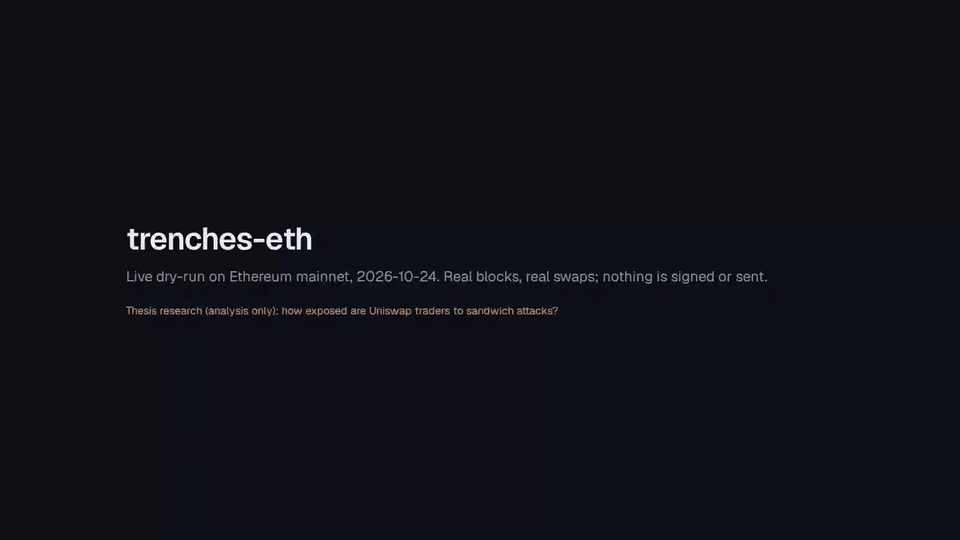
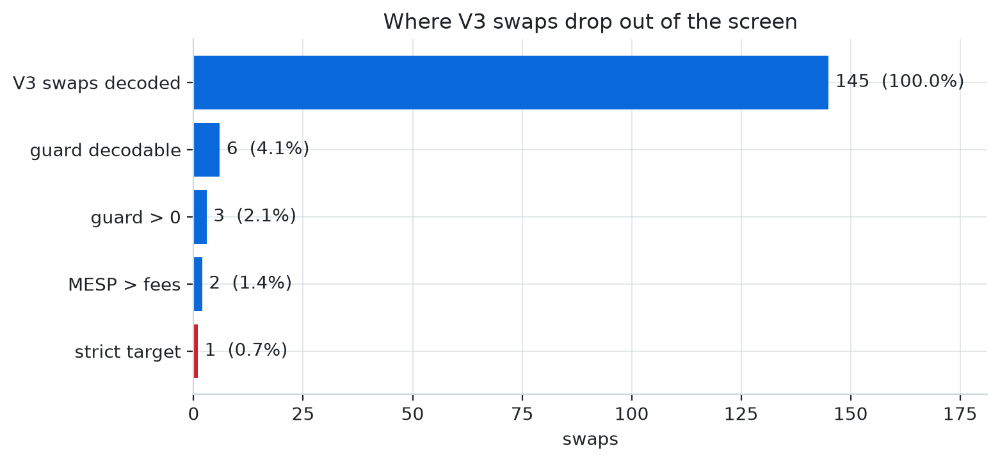

# trenches-eth: Ethereum Sandwich-Exposure Analysis

<a href="docs/research/figures/readme/platform.mp4"></a>

<sub>Recorded live on Ethereum mainnet, 2026-10-24, 20:19 to 20:25 UTC (blocks 26,264,750 to 26,264,890). Real decoded swaps, nothing mocked and nothing sent. Click for the MP4.</sub>

## Why this exists

This repository was built for my thesis on the analysis of crypto-market
activity. **It is a research instrument, not a trading system.** It watches
Ethereum, measures how exposed ordinary DEX traders are to sandwich attacks,
labels the attacks that actually happened, and replays the opportunities
through a counterfactual model to ask one question: could anyone outside the
private order-flow pipes even see this, let alone profit from it?

Every command runs as a **dry-run that signs and sends nothing**. The
execution code that prices gas, fees and builder bribes is kept only so the
cost model uses real calldata and bundle shapes; it is switched off behind
hard gates and has never been configured. Sandwich attacks harm the traders
they target. Nothing here is a recommendation to run one.

The short answer the data gives: **from the public mempool, mostly no.**

## The idea

A trader swapping on Uniswap signs a **slippage guard**: the least they will
accept (`amountOutMin` on V2, `amountOutMinimum` on V3). A sandwich attacker
sees the swap before it lands, buys just ahead of it to push the price up,
lets the victim buy at the worse price, then sells straight back. The
attacker's take is bounded by that guard: push too hard and the victim's
transaction reverts, and the attacker is left holding the position.

So the guard is the whole story. Three things decide whether a swap is
really exposed:

1. **Can you see the guard?** It sits in the calldata, but only if the swap
   goes through a router you can decode. Aggregators, UniversalRouter command
   strings and private MEV-bot routers each hide it differently.
2. **How much room does it leave?** A guard 0.01% under the expected output
   leaves almost nothing; a guard at zero leaves the whole pool.
3. **Is the room worth more than the cost of landing first?** Gas, the
   EIP-1559 priority fee, the builder bribe, the flash-loan fee, and the races
   you lose to searchers with private order flow.

The pipeline measures all three, then checks the measurements against
ground truth: sandwiches that actually landed on chain, recognised by the
order of transactions inside a block.

```
mempool / newHeads ─▶ onchain.decode ─▶ measure.exposure ─▶ measure.screen ─▶ strategy.allocation
                      (V2, V3, routers)  (MESP per swap)     (strict targets)   (counterfactual P&L)
confirmed blocks ──▶ measure.detection (inclusion order) ───────────────────▶ settlement ground truth
```

## The model in formulas

### Exposure on a constant-product pool (Uniswap V2)

A V2 pool holds reserves $`x`$ (WETH, the numeraire) and $`y`$ (the token)
with $`xy = k`$ and a fee $`r`$ (30 bps). Putting $`n`$ net WETH in returns

```math
t(n) = \frac{y\,n}{x + n}, \qquad (x, y) \to (x + n,\; y - t(n))
```

An attacker front-runs a victim buy of size $`a`$ with $`D`$ WETH. The pool
moves to $`(x_1, y_1)`$, the victim executes there, the pool moves to
$`(x_2, y_2)`$, and the attacker sells the $`t_1`$ tokens back:

```math
t_1 = t(D)\big|_{x,y}, \qquad
\pi(D) = \frac{x_2\,t_1}{y_2 + t_1}\,(1 - r) - D\,(1 + r)
```

subject to the victim's guard still holding at the manipulated price,
$`t(a/(1+r))\big|_{x_1,y_1} \ge \text{amountOutMin}`$. The victim's price
worsens monotonically in $`D`$, so the feasible set is an interval
$`[0, D_{\max}]`$, found by 60 rounds of bisection. On it, $`\pi`$ is
unimodal and maximised by golden-section search
($`\varphi = (\sqrt 5 - 1)/2`$, 80 iterations):

```math
\mathrm{MESP} = \max_{0 \le D \le \min(D_{\max},\, C)} \pi(D)
```

$`C`$ caps the front at the capital an attacker plausibly holds (1 ETH in
the strict screen), because a victim with no guard otherwise "yields"
whatever dumping half the pool would.

The victim's **slack** is how far its average price may worsen before the
guard binds:

```math
s = \frac{t(a/(1+r))\big|_{x,y}}{\text{amountOutMin}} - 1
```

<picture>
  <source media="(prefers-color-scheme: dark)" srcset="docs/research/figures/readme/exposure-dark.png">
  
</picture>

The figure runs the model on an example victim: a 5 ETH buy into a 100 ETH
pool with 3% slack. Profit rises with $`D`$ the whole way, so the optimum
always sits on the feasibility boundary: **the guard sets the take, not the
pool.** Here MESP is 0.143 ETH at a 1.53 ETH front; beyond that the victim
reverts.

### Exposure on a concentrated-liquidity pool (Uniswap V3)

V3 stores price as a Q64.96 square root, $`\sqrt P = \text{sqrtPriceX96}/2^{96}`$,
and liquidity $`L`$ is a step function of the tick $`i`$, with
$`\sqrt{P_i} = 1.0001^{i/2}`$. Inside one range, a swap of token0 in moves
the price and pays out token1 as

```math
\sqrt{P'} = \frac{L\sqrt P}{L + \Delta x\,\sqrt P}, \qquad
\Delta y = L\,(\sqrt P - \sqrt{P'})
```

Crossing an initialised tick changes $`L`$ by that tick's `liquidityNet`.
The implementation follows `SwapMath.computeSwapStep` in exact integers and
computes $`\sqrt{P_i}`$ as $`\lfloor 2^{96}\cdot 1.0001^{i/2}\rfloor`$ at
80-digit precision, so it does not depend on the hard-coded hex table in
`TickMath.sol`. The sandwich objective is the same three legs (front, victim,
back) evolved through this state. Because profit is only piecewise smooth
across ticks, the golden-section result is checked against the interval
midpoint.

### Guessing the guard when it is hidden

For most swaps the guard is not decodable. Instead of assuming a fixed 1%,
the guard estimator learns it from the swaps where it is visible. Each
decodable swap contributes its realised slack

```math
s_j = \frac{\text{actual out}_j}{\text{amountOutMinimum}_j} - 1
```

and a hidden guard is reconstructed from a percentile $`q`$ of that
empirical distribution (median by default, `MEV_GUARD_PERCENTILE`):

```math
\widehat{\text{amountOutMinimum}} = \frac{\text{actual out}}{1 + Q_q(s)}
```

### Who is a likely victim

The scorer outputs $`p`$, the probability that a swap gets sandwiched. It
has a slot for a LightGBM model over $`(s,\ \log_{10} x,\ f)`$, where
$`f`$ counts strict swaps on the same pool in the last 12 blocks. **No model
is trained yet**: training needs labelled sandwiches, and the recorded window
holds none (see below). Until then $`p`$ is a deliberately humble heuristic,
saturating at 0.40 because the Solana predecessor never measured precision
above about 40%:

```math
p = \operatorname{clip}\!\left(0.02 + 0.10\,\log_{10}(1 + s) + 0.004\,\min(f, 5),\ 0,\ 0.40\right)
```

A swap is a **strict target** when MESP with a 1 ETH cap is at least
0.01 ETH, the front fits the cap, and the return on the front is at least 1%.

### The counterfactual allocator

Would a disciplined extractor with 1 ETH make money on these targets? The V2
allocator commits capital $`\kappa`$ only when the expected net return clears
a threshold that relaxes as the wallet $`w`$ grows:

```math
q = \min\!\big(p\,(1 + 0.1\min(f,5)),\ 0.95\big), \qquad
\mu = q\,\mathrm{ROI} - (1-q)\,a - \beta f (1-p)
```

```math
\theta(w) = \theta_\infty + (\theta_0 - \theta_\infty)\,e^{-w/C_0}, \qquad
\text{commit} \iff \mu \ge \theta(w)
```

with adverse unwind $`a = 1\%`$, crowding penalty $`\beta = 0.004`$,
$`\theta_0 = 0.012`$, $`\theta_\infty = 0.004`$, and a scarce-wallet rule
$`\kappa \le 0.5\,w`$ while $`w \le C_0`$. Each position resolves 12 blocks
later against the **real** settlement feed:

| Outcome | When | Gain |
|---|---|---|
| win | a real sandwich hit the victim, and we land first (prob. WR) | $`\max(0,\ c(\pi)\,\pi - L)`$ |
| outbid | a real sandwich hit the victim, someone else landed first | $`-L`$ |
| no sandwich | nobody touched the victim | $`-a\,\kappa - \text{gas}`$ |

where $`\pi`$ is the predicted MESP, $`c(\pi)`$ the realised capture share
(0.19 for $`\pi \ge 0.01`$ ETH, 0.6 below, the size dependence measured on
Solana), and $`L`$ the EIP-1559 cost of landing ahead:

```math
L = \text{bribe} + \text{priority fee}\times 300{,}000 + \text{gas}
```

The V3 allocator borrows the front with a flash loan, so the bankroll only
pays costs. With front $`F`$, flash fee $`\phi`$ (5 bps) and gas price $`g`$:

```math
L(F) = 4 \cdot 160{,}000 \cdot g + \text{bribe} + \phi F, \qquad
\mathbb{E}[\text{gain}] = \mathrm{WR}\cdot\mathrm{CF}\cdot\mathrm{MESP} - L(F)
```

```math
\text{commit} \iff \mathrm{MESP} > \frac{L(F)}{\mathrm{WR}\cdot\mathrm{CF}}
```

At the defaults (WR 0.5, capture fraction CF 0.25, 0.2 gwei, 0.0002 ETH
bribe), a 1.5 ETH front needs MESP above about 0.0086 ETH.

### Ground truth: which sandwiches really happened

Ethereum sandwiches settle inside one block, so detection is about
transaction order (the mev-inspect approach). In one pool and one block, an
address $`A`$ sandwiches victim $`v`$ when $`A`$ has swaps $`f`$ and $`b`$
with

```math
f < v < b, \qquad d(f) = d(v) = -d(b), \qquad \mathrm{owner}(v) \ne A, \qquad
0.5\,\tau_f \le \tau_b \le 1.01\,\tau_f
```

where $`d`$ is the sign of the token0 flow and $`\tau`$ the token0 amount
of each leg: the back leg must unwind roughly what the front leg bought.
The attacker's profit is the net token0 over both legs.

### Cross-pool arbitrage

The same pricing code measures the non-harmful counterpart: price gaps
between pools of the same pair. Borrow $`A`$ WETH, buy on the cheap pool,
sell on the expensive one, repay with fee $`\phi`$:

```math
\pi(A) = \mathrm{out}_{\mathrm{sell}}\big(\mathrm{out}_{\mathrm{buy}}(A)\big) - A - \phi A
```

maximised by golden section over $`[0, \text{loan cap}]`$, then compared
with gas and bribe.

### How the replay is scored

Selection knobs are tuned on the first 80% of blocks and reported on the
last 20%. The win rate WR cannot be measured offline, so every result is
reported across WR in 0.1 to 0.9 and the capture fraction across 0.19 to
0.60, each averaged over 20 Monte-Carlo seeds.

## What the data shows

### Most of the market is invisible

<picture>
  <source media="(prefers-color-scheme: dark)" srcset="docs/research/figures/readme/funnel-dark.png">
  
</picture>

In a 146-swap mainnet window, **only 4.1% of V3 swaps carried a guard I
could decode**. The rest went through aggregators (1inch, 0x, ParaSwap),
UniversalRouter command strings or private routers. Adding decoders for each
raised coverage to about 25%, but the collapse happens before any filter
parameter applies: this is a visibility problem, not a tuning problem. Half
of the decodable swaps set no guard at all, and only 1 in 145 ended up a
strict target.

The V2 side is thinner still. Over 202 recorded blocks (1,404 swaps across
411 pools) only **27 swaps (1.9%)** were direct Router02 calls with a
readable `amountOutMin`, and **zero sandwiches** were detected. A 55-second
mempool probe saw 0 V2 router calls among 323 pending transactions.

### The victims that are visible leave almost no room

<picture>
  <source media="(prefers-color-scheme: dark)" srcset="docs/research/figures/readme/guard-dark.png">
  
</picture>

Across 2,760 decodable V3 swaps collected over 3.0 hours:

| Statistic | Guard slack |
|---|---|
| median | 0.0002% |
| share below 0.1% | 79.9% |
| 90th percentile | 0.76% |
| share at 5% or more | 0.5% |

Four in five visible swaps set a guard within 0.1% of what they received.
That is consistent with the decodable population being dominated by bots and
tight-slippage interfaces rather than careless retail traders. It also means
the guard estimator's median, learned on this population, is a conservative
default for the hidden majority, and a selection bias worth keeping in mind.

### Exposure exists, but it is concentrated

The V3 model does find real exposure when a guard is loose: a victim with 10%
slippage room moving a pool about 5% leaves **about 0.48 ETH** extractable
on a 5 ETH front. Those victims are rare, and the right tail of the slack
distribution above is where all of them live.

### Counterfactual verdict: no-go

The replay harness works end to end: a smoke test with realistic rows
produced 80 commits and exercised all three outcomes (wins, outbids, no
sandwich), finishing at -0.17 ETH. Three things keep the verdict negative:

- **The win rate is unknowable from public data**, and on Solana the
  identical allocator only turned clearly positive above WR 0.6 to 0.7. A
  public-mempool searcher competes against builders with private order flow,
  so the honest prior is low.
- **The landing cost is paid on every attempt.** At V2 defaults the gas and
  bribe alone are 0.0175 ETH per race, above the 0.01 ETH strict floor.
- **The ground-truth window holds no sandwiches** on the visible V2 subset, so
  there is nothing yet to train the victim model on.

## Where it fails

- **Private order flow is out of reach by construction.** Flashbots Protect,
  MEV-Share and builder-direct flow never reach the public mempool, so every
  rate above is a rate over the visible subset only.
- **The V3 pools are read as a single active range.** The tick bitmap is
  not fetched yet, so exposures that cross a tick are approximated.
- **Short windows.** Three hours of guard data and 202 blocks of V2 ground
  truth support the qualitative conclusion, not tight confidence intervals.
- **Private-router decoders are reverse-engineered**, so the exposure step
  rejects anything with MESP above 100 times its front as a likely unit
  error.

## What is left to finish

1. **A multi-day ground-truth window** with V3 sandwich detection, so the
   sandwich rate has a confidence interval.
2. **Train the victim model** on those labels and compare it with the
   heuristic on a held-out week.
3. **Fetch the V3 tick bitmap** so exposures across tick boundaries are exact.
4. **Guard visibility by router family:** extend the decoders and measure how
   the slack distribution changes as coverage grows.
5. **Write the thesis chapter** from `docs/research/` with the figures above.

## Running it

```bash
python3.12 -m venv .venv && .venv/bin/pip install -e '.[dev,figures]'
cp .env.example .env                 # set ETH_RPC_URL / ETH_WS_URL (read-only)
.venv/bin/python -m pytest           # 100 checks under scripts/checks

.venv/bin/python . v3 --port 8080    # V3 exposure funnel, live dashboard
.venv/bin/python . collect --hours 3 # record ground truth into data/
.venv/bin/python . report --db data/gt_*/live.duckdb
.venv/bin/python -m scripts.figures.readme
```

`python3 .` with no command lists every command. Gathered data stays local
under `data/` and is never committed.

```
eth_mev/        the analysis package
  app/          dry-run screeners (v2, v3, arb), dashboard, run store
  onchain/      node access (RPC, mempool, heads) and swap decoding
  measure/      exposure maths, sandwich detection, screen, guard estimator, arb pricing
  strategy/     counterfactual allocation models, gated execution path
scripts/        checks (tests), ground-truth collection, finetune replay, figures
docs/           research (methodology, findings, figures) and the original build prompts
```

## License

trenches-eth is **source-available**, licensed under the [PolyForm Noncommercial License 1.0.0](./LICENSE), **not** an OSI open-source license.

- **You may** use, modify, fork, and share trenches-eth freely for any **noncommercial** purpose, as long as you keep the copyright and `Required Notice:` lines (see [`NOTICE`](./NOTICE)) and credit *"trenches-eth by Keygraph, Inc."*
- **You may not** sell it, bundle it into a paid product, or run it as a paid/hosted service **without a commercial license**.

Copyright (c) 2026 Keygraph, Inc. Commercial licensing enquiries: see [`NOTICE`](./NOTICE).
