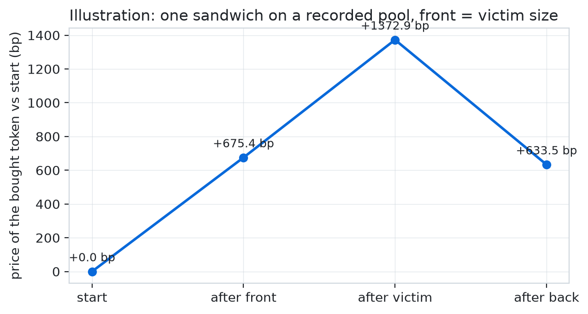
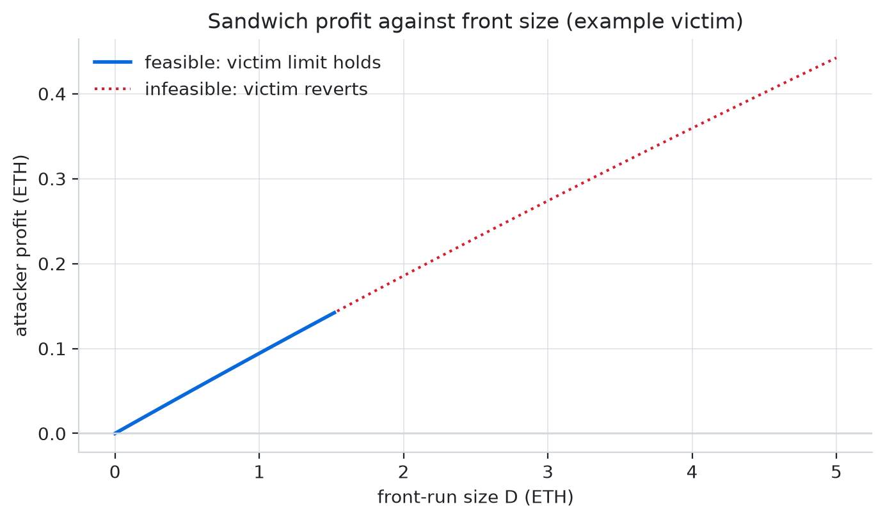
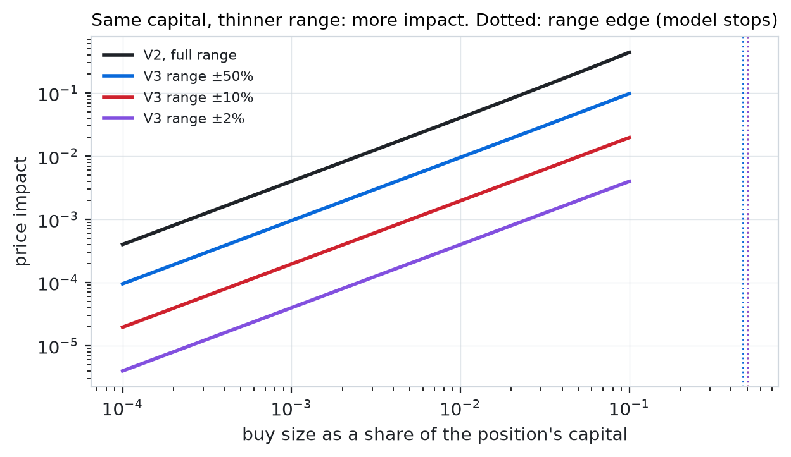
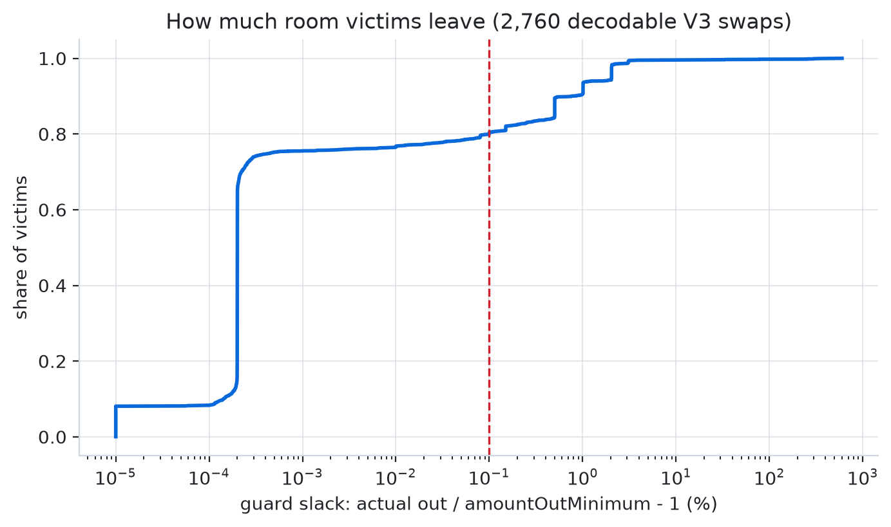
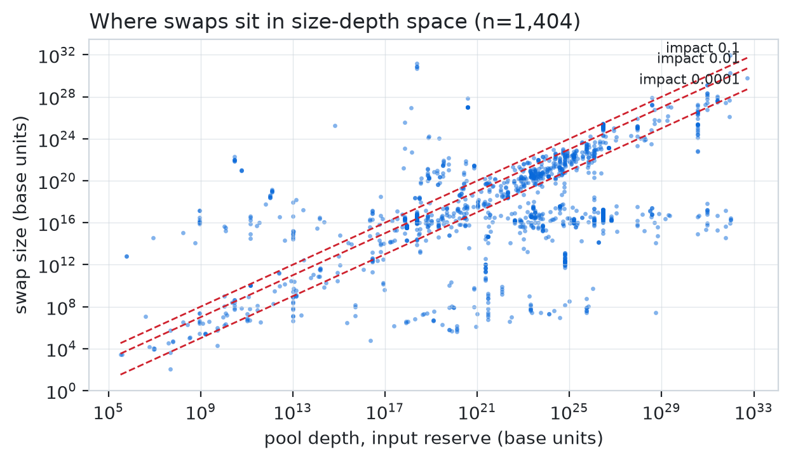
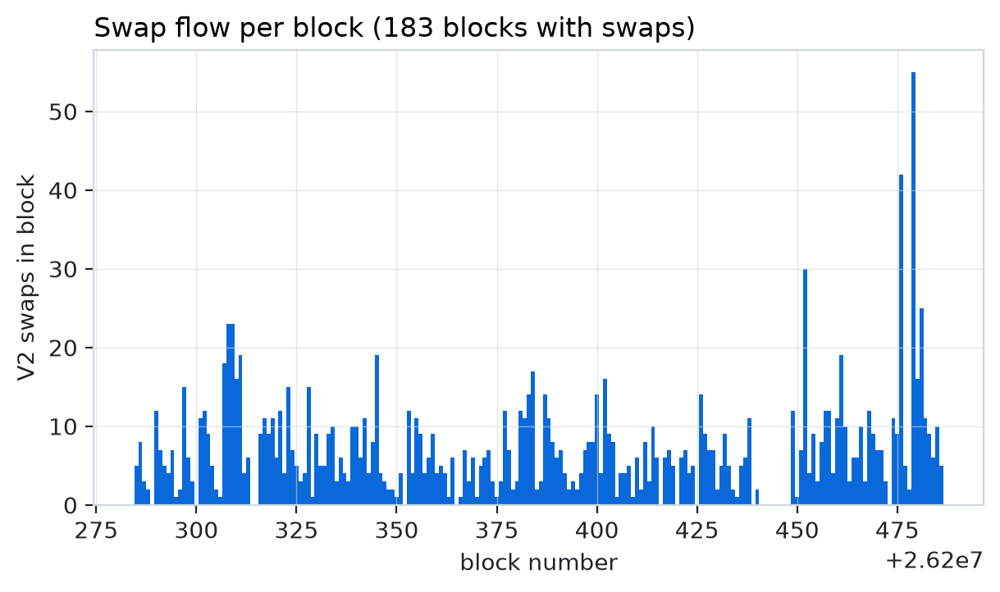
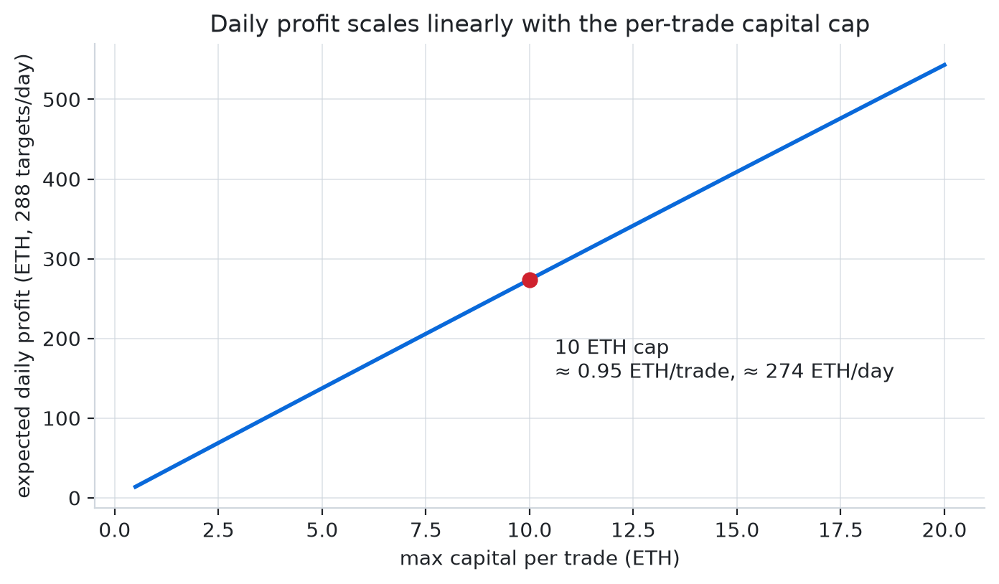
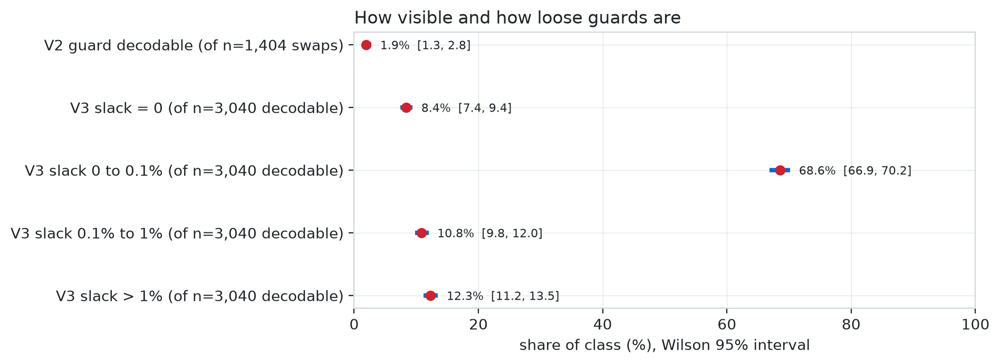
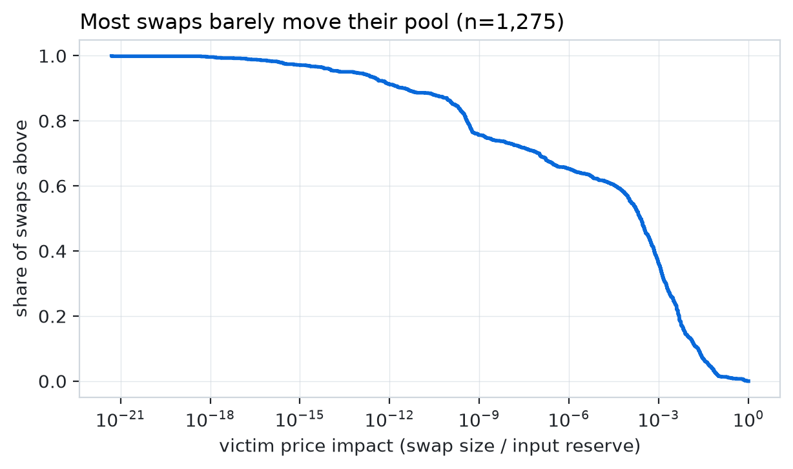
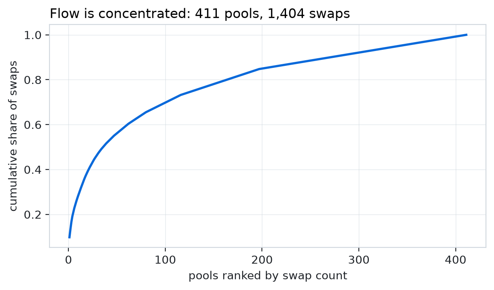

# trenches-eth: Ethereum Sandwich-Exposure Analysis

> **Dropped.** The profitable numbers below need a large front, and that front
> cannot be borrowed: a flash loan repays atomically in a single transaction,
> while a sandwich is two transactions. That leaves only our own capital, which
> was too low to produce a reliable daily return.

## What this actually was

This project started as an attempt to build a **high-frequency trading strategy**,
not a research paper. The idea was simple: watch for a large swap before it
lands, jump in front of it, and sell straight back out at the price the victim's
own trade just moved. We were trying to build something that made money, and we
called it that.

The idea did **not** work on Solana, and not for lack of trying. Solana has no
public mempool (transactions are forwarded straight to the upcoming leader), and
Jito shut its mempool stream down in March 2024 specifically to stop these
attacks. A way around it still exists, paid Geyser/gRPC and preconfirmation
streams, and we researched it in detail, but the cost of that data was far too
high for what it would buy. So we moved to Ethereum, which has a public mempool,
and built this repository as the successor to
[`tr4m0ryp/trenches-live`](https://github.com/tr4m0ryp/trenches-live).

On Ethereum the mechanism **works**, which is the reason the project lives here.
The front-run model produces positive, fee-net profit on loose-guard victims, and
that profit scales with the capital you commit to each trade. The
[capital section](#what-the-per-trade-cap-actually-buys) below shows the numbers. What stopped us from turning it into a live bot was a combination of the
honest caveats measured throughout this document, the cost of landing first and
the trades hidden in private order flow, and, more importantly, the conclusion
that what we were building is **sandwiching**: it extracts value from ordinary
traders, it is not clearly legal, and it is not something we want to run or
recommend.

Every command here still runs as a **dry-run that signs and sends nothing**. The
execution code that prices gas, fees and builder bribes is kept only so the cost
model uses real calldata and bundle shapes; it is switched off behind hard gates
and has never been configured. To make this into a real deployment the only
thing that needs to be added is a funded hot-wallet key and the `LIVE` flag, plus
a builder signing key for relay submission: the bundle assembly, signing and
`eth_sendBundle` path is already written and only gated, not missing. We removed
the live runner on purpose, and removed it from the git history, for the ethical
reasons above: sandwich attacks harm the traders they target, and nothing here is
a recommendation to run one.

## The idea

A trader swapping on Uniswap signs a **slippage guard**: the least they will
accept (`amountOutMin` on V2, `amountOutMinimum` on V3). A sandwich attacker
sees the swap before it lands, buys just ahead of it to push the price up,
lets the victim buy at the worse price, then sells straight back. The
attacker's take is bounded by that guard: push too hard and the victim's
transaction reverts, and the attacker is left holding the position.

So the guard is the whole story. Three things decide whether a swap is
really exposed:

1. **Can you see the guard?** It sits in the calldata, but only if the swap
   goes through a router you can decode. Aggregators, UniversalRouter command
   strings and private MEV-bot routers each hide it differently.
2. **How much room does it leave?** A guard 0.01% under the expected output
   leaves almost nothing; a guard at zero leaves the whole pool.
3. **Is the room worth more than the cost of landing first?** Gas, the
   EIP-1559 priority fee, the builder bribe, the flash-loan fee, and the races
   you lose to searchers with private order flow.

The pipeline measures all three, then checks the measurements against
ground truth: sandwiches that actually landed on chain, recognised by the
order of transactions inside a block.

```
mempool / newHeads ─▶ onchain.decode ─▶ measure.exposure ─▶ measure.screen ─▶ strategy.allocation
                      (V2, V3, routers)  (MESP per swap)     (strict targets)   (counterfactual P&L)
confirmed blocks ──▶ measure.detection (inclusion order) ───────────────────▶ settlement ground truth
```

<picture>
  <source media="(prefers-color-scheme: dark)" srcset="docs/research/figures/readme/path-dark.png">
  
</picture>

<sub>Illustration, not a measurement: the p90-impact victim of the recorded V2 window (source: `included_swaps`, 1,404 swaps), a front the size of the victim. The price ends above its start because the victim's own impact stays.</sub>

## The model in formulas

### Exposure on a constant-product pool (Uniswap V2)

A V2 pool holds reserves $`x`$ (WETH, the numeraire) and $`y`$ (the token)
with $`xy = k`$ and a fee $`r`$ (30 bps). Putting $`n`$ net WETH in returns

```math
t(n) = \frac{y\,n}{x + n}, \qquad (x, y) \to (x + n,\; y - t(n))
```

An attacker front-runs a victim buy of size $`a`$ with $`D`$ WETH. The pool
moves to $`(x_1, y_1)`$, the victim executes there, the pool moves to
$`(x_2, y_2)`$, and the attacker sells the $`t_1`$ tokens back:

```math
t_1 = t(D)\big|_{x,y}, \qquad
\pi(D) = \frac{x_2\,t_1}{y_2 + t_1}\,(1 - r) - D\,(1 + r)
```

subject to the victim's guard still holding at the manipulated price,
$`t(a/(1+r))\big|_{x_1,y_1} \ge \text{amountOutMin}`$. The victim's price
worsens monotonically in $`D`$, so the feasible set is an interval
$`[0, D_{\max}]`$, found by 60 rounds of bisection. On it, $`\pi`$ is
unimodal and maximised by golden-section search
($`\varphi = (\sqrt 5 - 1)/2`$, 80 iterations):

```math
\mathrm{MESP} = \max_{0 \le D \le \min(D_{\max},\, C)} \pi(D)
```

$`C`$ caps the front at the capital an attacker plausibly holds (1 ETH in
the strict screen), because a victim with no guard otherwise "yields"
whatever dumping half the pool would.

The victim's **slack** is how far its average price may worsen before the
guard binds:

```math
s = \frac{t(a/(1+r))\big|_{x,y}}{\text{amountOutMin}} - 1
```

<picture>
  <source media="(prefers-color-scheme: dark)" srcset="docs/research/figures/readme/exposure-dark.png">
  
</picture>

The figure runs the model on an example victim: a 5 ETH buy into a 100 ETH
pool with 3% slack. Profit rises with $`D`$ the whole way, so the optimum
always sits on the feasibility boundary: **the guard sets the take, not the
pool.** Here MESP is 0.143 ETH at a 1.53 ETH front; beyond that the victim
reverts.

### Exposure on a concentrated-liquidity pool (Uniswap V3)

V3 stores price as a Q64.96 square root, $`\sqrt P = \text{sqrtPriceX96}/2^{96}`$,
and liquidity $`L`$ is a step function of the tick $`i`$, with
$`\sqrt{P_i} = 1.0001^{i/2}`$. Inside one range, a swap of token0 in moves
the price and pays out token1 as

```math
\sqrt{P'} = \frac{L\sqrt P}{L + \Delta x\,\sqrt P}, \qquad
\Delta y = L\,(\sqrt P - \sqrt{P'})
```

Crossing an initialised tick changes $`L`$ by that tick's `liquidityNet`.
The implementation follows `SwapMath.computeSwapStep` in exact integers and
computes $`\sqrt{P_i}`$ as $`\lfloor 2^{96}\cdot 1.0001^{i/2}\rfloor`$ at
80-digit precision, so it does not depend on the hard-coded hex table in
`TickMath.sol`. The sandwich objective is the same three legs (front, victim,
back) evolved through this state. Because profit is only piecewise smooth
across ticks, the golden-section result is checked against the interval
midpoint.

<picture>
  <source media="(prefers-color-scheme: dark)" srcset="docs/research/figures/readme/v3range-dark.png">
  
</picture>

<sub>Model formula only: price impact $`(1+s/L)^2-1`$ for equal capital in a full-range V2 position and V3 ranges of ±50%, ±10% and ±2%. Dots mark the range edge, where the single-range approximation ends.</sub>

### Guessing the guard when it is hidden

For most swaps the guard is not decodable. Instead of assuming a fixed 1%,
the guard estimator learns it from the swaps where it is visible. Each
decodable swap contributes its realised slack

```math
s_j = \frac{\text{actual out}_j}{\text{amountOutMinimum}_j} - 1
```

and a hidden guard is reconstructed from a percentile $`q`$ of that
empirical distribution (median by default, `MEV_GUARD_PERCENTILE`):

```math
\widehat{\text{amountOutMinimum}} = \frac{\text{actual out}}{1 + Q_q(s)}
```

<picture>
  <source media="(prefers-color-scheme: dark)" srcset="docs/research/figures/readme/guard-dark.png">
  
</picture>

<sub>Source: `guard_slacks`, n=3,040 decodable V3 guards (2,760 from 2026-10-16, 280 from 2026-10-24).</sub>

### Who is a likely victim

The scorer outputs $`p`$, the probability that a swap gets sandwiched. It
has a slot for a LightGBM model over $`(s,\ \log_{10} x,\ f)`$, where
$`f`$ counts strict swaps on the same pool in the last 12 blocks. **No model
is trained yet**: training needs labelled sandwiches, and the recorded window
holds none (see below). Until then $`p`$ is a deliberately humble heuristic,
saturating at 0.40 because the Solana predecessor never measured precision
above about 40%:

```math
p = \mathrm{clip}\!\left(0.02 + 0.10\,\log_{10}(1 + s) + 0.004\,\min(f, 5),\ 0,\ 0.40\right)
```

A swap is a **strict target** when MESP with a 1 ETH cap is at least
0.01 ETH, the front fits the cap, and the return on the front is at least 1%.

<picture>
  <source media="(prefers-color-scheme: dark)" srcset="docs/research/figures/readme/sizedepth-dark.png">
  
</picture>

<sub>Source: `included_swaps`, n=1,404 V2 swaps. Dashed lines are constant price impact; a swap near the top-left line moves its pool most.</sub>

### The counterfactual allocator

Would a disciplined extractor with 1 ETH make money on these targets? The V2
allocator commits capital $`\kappa`$ only when the expected net return clears
a threshold that relaxes as the wallet $`w`$ grows:

```math
q = \min\!\big(p\,(1 + 0.1\min(f,5)),\ 0.95\big), \qquad
\mu = q\,\mathrm{ROI} - (1-q)\,a - \beta f (1-p)
```

```math
\theta(w) = \theta_\infty + (\theta_0 - \theta_\infty)\,e^{-w/C_0}, \qquad
\text{commit} \iff \mu \ge \theta(w)
```

with adverse unwind $`a = 1\%`$, crowding penalty $`\beta = 0.004`$,
$`\theta_0 = 0.012`$, $`\theta_\infty = 0.004`$, and a scarce-wallet rule
$`\kappa \le 0.5\,w`$ while $`w \le C_0`$. Each position resolves 12 blocks
later against the **real** settlement feed:

| Outcome | When | Gain |
|---|---|---|
| win | a real sandwich hit the victim, and we land first (prob. WR) | $`\max(0,\ c(\pi)\,\pi - L)`$ |
| outbid | a real sandwich hit the victim, someone else landed first | $`-L`$ |
| no sandwich | nobody touched the victim | $`-a\,\kappa - \text{gas}`$ |

where $`\pi`$ is the predicted MESP, $`c(\pi)`$ the realised capture share
(0.19 for $`\pi \ge 0.01`$ ETH, 0.6 below, the size dependence measured on
Solana), and $`L`$ the EIP-1559 cost of landing ahead:

```math
L = \text{bribe} + \text{priority fee}\times 300{,}000 + \text{gas}
```

The V3 allocator borrows the front with a flash loan, so the bankroll only
pays costs. With front $`F`$, flash fee $`\phi`$ (5 bps) and gas price $`g`$:

```math
L(F) = 4 \cdot 160{,}000 \cdot g + \text{bribe} + \phi F, \qquad
\mathbb{E}[\text{gain}] = \mathrm{WR}\cdot\mathrm{CF}\cdot\mathrm{MESP} - L(F)
```

```math
\text{commit} \iff \mathrm{MESP} > \frac{L(F)}{\mathrm{WR}\cdot\mathrm{CF}}
```

At the defaults (WR 0.5, capture fraction CF 0.25, 0.2 gwei, 0.0002 ETH
bribe), a 1.5 ETH front needs MESP above about 0.0086 ETH.

### Ground truth: which sandwiches really happened

Ethereum sandwiches settle inside one block, so detection is about
transaction order (the mev-inspect approach). In one pool and one block, an
address $`A`$ sandwiches victim $`v`$ when $`A`$ has swaps $`f`$ and $`b`$
with

```math
f < v < b, \qquad d(f) = d(v) = -d(b), \qquad \mathrm{owner}(v) \ne A, \qquad
0.5\,\tau_f \le \tau_b \le 1.01\,\tau_f
```

where $`d`$ is the sign of the token0 flow and $`\tau`$ the token0 amount
of each leg: the back leg must unwind roughly what the front leg bought.
The attacker's profit is the net token0 over both legs.

<picture>
  <source media="(prefers-color-scheme: dark)" srcset="docs/research/figures/readme/flow-dark.png">
  
</picture>

<sub>Source: `included_swaps`, 183 blocks. Red blocks hold one wallet trading one pool twice, the pattern the detector checks first.</sub>

### Cross-pool arbitrage

The same pricing code measures the non-harmful counterpart: price gaps
between pools of the same pair. Borrow $`A`$ WETH, buy on the cheap pool,
sell on the expensive one, repay with fee $`\phi`$:

```math
\pi(A) = \mathrm{out}_{\mathrm{sell}}\big(\mathrm{out}_{\mathrm{buy}}(A)\big) - A - \phi A
```

maximised by golden section over $`[0, \text{loan cap}]`$, then compared
with gas and bribe.

### How the replay is scored

Selection knobs are tuned on the first 80% of blocks and reported on the
last 20%. The win rate WR cannot be measured offline, so every result is
reported across WR in 0.1 to 0.9 and the capture fraction across 0.19 to
0.60, each averaged over 20 Monte-Carlo seeds.

## What the per-trade cap actually buys

Profit on a single sandwich is linear in the front, but only while a victim big
enough to absorb that front exists, and the return is set by two measured
distributions. The **return per trade is the victim's own price impact**: in the
1,275 real swaps we recorded, the median victim moved its pool 0.025% and only
the 90th percentile moved it 2.1%. The **slack caps the front**: the median
victim left 0.0002% slack, so a large front makes it revert before you can
profit. The 9.5% return from the first reading of this is the far tail of both
distributions at once, not the market.

Running both distributions through the model gives the curve below. At a 10 ETH
front the expected daily profit is on the order of **tens of ETH per day**, and
it stops growing past roughly 20 ETH because most victims cannot absorb a larger
front without reverting.

### Why it is linear, and where it stops

On a constant-product pool with reserves $`(x, y)`$ and fee $`r`$, a front of $`D`$
net numeraire buys $`t_1 = \frac{y D}{x + D}`$ tokens and leaves the pool at
$`(x + D,\ \frac{y x}{x + D})`$. After a victim buy of $`a`$ net numeraire the pool
is $`(x + D + a,\ \frac{y x}{x + D + a})`$, and selling the $`t_1`$ tokens back
returns

```math
\mathrm{sellback}(D) = \frac{(x + D + a)^{2}\,D}{(x + D)^{2} + D\,a}
```

Expanding to first order in $`D`$ around zero,
$`\mathrm{sellback}'(0) = \frac{(x + a)^{2}}{x^{2}}`$, so the sandwich profit for a
front small against the pool is

```math
\pi(D) = (1 - r)\,\mathrm{sellback}(D) - (1 + r)\,D
       \approx \left(2\frac{a}{x} - 2r\right)D
```

The slope is twice the victim's own price impact $`a/x`$ minus the round-trip fee.
The return per trade is set by how hard the victim's trade moves the pool, not by
anything the attacker controls, and it is positive only while $`a/x > r`$, which is
why small-impact victims are never worth sandwiching. The victim's slack $`s`$
enters only through the feasibility boundary: the victim reverts when its output
falls below $`\text{amountOutMin} = t_{\text{victim}}(0) / (1 + s)`$, i.e. when

```math
\frac{t_{\text{victim}}(D)}{t_{\text{victim}}(0)}
= \frac{x\,(x + a)}{(x + D)\,(x + D + a)}
= \frac{1}{1 + s}
```

which, when the victim's trade is small against the pool, solves to

```math
D_{\max} \approx \frac{x\,s}{2}
```

Putting the two together, a single victim contributes

```math
\mathrm{MESP}(D) = \min\left(D,\ \frac{x\,s}{2}\right)\cdot\left(2\frac{a}{x} - 2r\right)
```

linear in the front up to $`x s / 2`$ and infeasible past it. Each victim is a line
of slope $`2a/x - 2r`$ cut off at $`x s / 2`$; once the front is large enough that
the remaining victims are all cut off by their own guard, more capital buys nothing,
which is the saturation in the figure.

<picture>
  <source media="(prefers-color-scheme: dark)" srcset="docs/research/figures/readme/capital-daily-dark.png">
  
</picture>

| front | daily EV, WR x capture 0.125 | daily EV, WR x capture 0.25 |
|---|---|---|
| 0.09 ETH (own capital) | about 0.5 ETH | about 1.2 ETH |
| 1 ETH | about 7 ETH | about 14 ETH |
| 10 ETH | about 38 ETH | about 76 ETH |
| 20 ETH | about 43 ETH | about 86 ETH |
| 50 ETH | about 49 ETH | about 100 ETH |

The figure is computed from the two recorded distributions, not a recorded run,
and the two columns span the honest uncertainty in win rate and capture. The
leftmost row is the reason this was dropped: at our own capital the return is
small and dominated by the rare high-impact tail, and the number only becomes
worth chasing at a front of a few ETH, which cannot be borrowed, because a flash
loan repays in one transaction while a sandwich is two.

## What the data shows

### Most of the market is invisible

<picture>
  <source media="(prefers-color-scheme: dark)" srcset="docs/research/figures/readme/visibility-dark.png">
  
</picture>

<sub>Shares with Wilson 95% intervals; n is in each label. Sources: `included_swaps` (V2, guard decodable in 27 of 1,404) and `guard_slacks` (V3).</sub>

Among recorded V2 swaps, **only 1.9% carried a guard I could decode**. In a short 146-swap V3 mainnet window the share was 4.1%, a small sample that agrees in direction. The rest went through aggregators (1inch, 0x, ParaSwap),
UniversalRouter command strings or private routers. Adding decoders for each
raised coverage to about 25%, but the collapse happens before any filter
parameter applies: this is a visibility problem, not a tuning problem. Half
of the decodable swaps set no guard at all, and only 1 in 145 ended up a
strict target.

The V2 side is thinner still. Over 202 recorded blocks (1,404 swaps across
411 pools) only **27 swaps (1.9%)** were direct Router02 calls with a
readable `amountOutMin`, and **zero sandwiches** were detected. A 55-second
mempool probe saw 0 V2 router calls among 323 pending transactions.

### The victims that are visible leave almost no room

Across 2,760 decodable V3 swaps collected over 3.0 hours:

| Statistic | Guard slack |
|---|---|
| median | 0.0002% |
| share below 0.1% | 79.9% |
| 90th percentile | 0.76% |
| share at 5% or more | 0.5% |

Four in five visible swaps set a guard within 0.1% of what they received.
That is consistent with the decodable population being dominated by bots and
tight-slippage interfaces rather than careless retail traders. It also means
the guard estimator's median, learned on this population, is a conservative
default for the hidden majority, and a selection bias worth keeping in mind.

### Exposure exists, but it is concentrated

The V3 model does find real exposure when a guard is loose: a victim with 10%
slippage room moving a pool about 5% leaves **about 0.48 ETH** extractable
on a 5 ETH front. Those victims are rare, and the right tail of the slack
distribution above is where all of them live.

Measured on the recorded V2 ground-truth window (1,404 swaps, 411 pools, 183 blocks). Most swaps move their pool by well under 1%, so a guard has little to absorb; the flow sits in a small set of pools; and activity is steady block to block.

<picture>
  <source media="(prefers-color-scheme: dark)" srcset="docs/research/figures/readme/impact-dark.png">
  
</picture>

<picture>
  <source media="(prefers-color-scheme: dark)" srcset="docs/research/figures/readme/pools-dark.png">
  
</picture>

## How the capital is kept safe from drainers

Front-running means holding a token for the length of the sandwich, so the token
itself is the first attack surface: a honeypot you cannot sell back, a tax that
eats the back leg, or a deployer who freezes or mints away the position. The
screener refuses a target on two independent layers before any capital is
exposed, and the victim model is the second line of defence.

### The token gate (hard reject, fail closed)

On Solana the check reads the mint account directly and rejects on:

- **freeze authority.** If set, the deployer can freeze the bot's token account
  and trap the back leg.
- **mint authority.** If set, the deployer can mint supply and dump it on the bot.
- **Token-2022 extensions.** A scan rejects `transfer_hook` (a program that can
  block or redirect transfers), `non_transferable` (cannot sell, the classic
  honeypot) and `transfer_fee` (a per-transfer tax). The scan matches exact
  payload sizes so a metadata string is not mistaken for an extension.

An unknown mint is treated as unsafe, never as safe. On Ethereum the same
protections come from simulation: every route is run through `eth_call` (or a
forked node) before it is enabled, and a route that reverts, or whose balance
delta is not sane, is rejected. That catches honeypots, taxed tokens and
non-transferable tokens without trusting a bytecode decoder.

### The opportunity gate (soft reject)

A clean token can still lose money, so three per-opportunity risks are scored
from the strict row and the model:

- **slippage.** The front size relative to the pool. A front that is a large
  share of the pool moves the price hard on the unwind and the back leg exits at
  a loss.
- **counterparty confidence.** The victim-model score. Below a floor the swap is
  unlikely to be a sandwich target, so the position is inventory risk with no
  victim to sell into.
- **competition.** The victim's priority fee. A victim paying a lot to land fast
  leaves a short window, and racing a bot is how a position is outbid.

### The model behind it

The victim model is a LightGBM over about 21 features, the strongest being the
fee-normalised impact `phi`, recent same-side pool flow, and the pool's attack
history. It is trained on the real sandwich labels (the H1/H2/H3 detector) and
graded live against them, so the same model that picks victims also refuses
traps: a token the gate does not trust, a swap the model does not score as a
victim, or a race it prices as too hot, is dropped before any capital moves.

## Running it

```bash
python3.12 -m venv .venv && .venv/bin/pip install -e '.[dev,figures]'
cp .env.example .env                 # set ETH_RPC_URL / ETH_WS_URL (read-only)
.venv/bin/python -m pytest           # 100 checks under scripts/checks

.venv/bin/python . v3 --port 8080    # V3 exposure funnel, live dashboard
.venv/bin/python . collect --hours 3 # record ground truth into data/
.venv/bin/python . report --db data/gt_*/live.duckdb
.venv/bin/python -m scripts.figures.readme
```

`python3 .` with no command lists every command. Gathered data stays local
under `data/` and is never committed.

```
eth_mev/        the analysis package
  app/          dry-run screeners (v2, v3, arb), dashboard, run store
  onchain/      node access (RPC, mempool, heads) and swap decoding
  measure/      exposure maths, sandwich detection, screen, guard estimator, arb pricing
  strategy/     counterfactual allocation models, gated execution path
scripts/        checks (tests), ground-truth collection, finetune replay, figures
docs/           research figures
```

## License

trenches-eth is **source-available**, licensed under the [PolyForm Noncommercial License 1.0.0](./LICENSE), **not** an OSI open-source license.

- **You may** use, modify, fork, and share trenches-eth freely for any **noncommercial** purpose, as long as you keep the copyright and `Required Notice:` lines (see [`NOTICE`](./NOTICE)) and credit *"trenches-eth by Keygraph, Inc."*
- **You may not** sell it, bundle it into a paid product, or run it as a paid/hosted service **without a commercial license**.

Copyright (c) 2026 Keygraph, Inc. Commercial licensing enquiries: see [`NOTICE`](./NOTICE).
